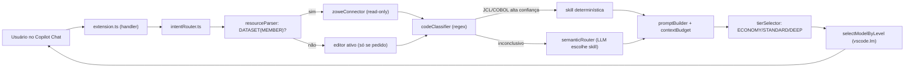

# Mainframe Hub Assistant — Briefing para análise

> Documento preparado para revisão externa. Nomes de usuário, datasets e termos corporativos foram trocados por valores fictícios.

## 1. O que é e para quem

Extensão do VS Code (versão `0.2.1`) que adiciona o participante de chat **`@mainframehub`** ao GitHub Copilot Chat.

**Público:** desenvolvedores mainframe (COBOL, JCL, DB2, CICS) do setor bancário, principalmente:
- quem está migrando do TSO/ISPF para o VS Code + Zowe;
- trainees e analistas que precisam de revisão de código e prevenção de abends.

**Problemas que tenta resolver:**
- Atrito na migração TSO/ISPF → VS Code ("como eu fazia isso no TSO?").
- Revisão de COBOL/JCL/DB2/CICS para evitar abends (S0C7, S0C4, -911) e reduzir consumo de CPU (MIPS).
- Custo de IA: usar modelos baratos em perguntas simples e caros só em análises pesadas.
- Segurança: acesso ao mainframe só de leitura, credenciais nunca enviadas ao modelo, confirmação para produção, editor lido só quando o usuário pede.

**Não é** uma extensão de linguagem: não tem gramática, syntax highlighting, snippets nem parser de COBOL. Esses recursos ficam com outras extensões (ex.: Zowe Explorer, IBM Z Open Editor). O COBOL é tratado por classificação heurística + prompts especializados (skills).

## 2. package.json (resumo)

```json
{
  "name": "mainframe-hub-assistant",
  "version": "0.2.1",
  "engines": { "vscode": "^1.89.0" },
  "main": "./out/extension.js",
  "contributes": {
    "chatParticipants": [{
      "id": "mainframe.hubAssistant",
      "name": "mainframehub",
      "commands": ["como-fazia-no-tso", "explicar", "onboarding", "abend"]
    }],
    "commands": [
      "mainframeHub.pinProfile", "mainframeHub.unpinProfile",
      "mainframeHub.testZoweReadOnly", "mainframeHub.testModelAccess",
      "mainframeHub.testGpt4oMiniCall", "mainframeHub.testContextProcessor",
      "mainframeHub.testJclSkillPipeline", "mainframeHub.testJclRouterPipeline",
      "mainframeHub.testJclLlmPipeline"
    ],
    "configuration": {
      "mainframeHub.workspaceProfile": "string",
      "mainframeHub.workspaceProfileEnabled": "boolean"
    }
  },
  "dependencies": {
    "@zowe/core-for-zowe-sdk": "^8.37.1",
    "@zowe/imperative": "^8.37.1",
    "@zowe/zos-files-for-zowe-sdk": "^8.37.1",
    "@zowe/zos-jobs-for-zowe-sdk": "^8.37.1",
    "@zowe/zowe-explorer-api": "^3.6.0"
  },
  "devDependencies": {
    "@types/node": "18.x", "@types/vscode": "^1.89.0",
    "@vscode/vsce": "^3.2.2", "typescript": "^5.3.3"
  }
}
```

Testes: `node --test` em 4 suítes (`core-hardening`, `profile-context`, `model-router`, `knowledge-selector`). Resultado atual: 82 testes, 82 aprovados.

## 3. Arquitetura



## 4. Arquivos principais (enviar nesta ordem)

| Arquivo | Papel |
|---|---|
| `src/extension.ts` | Ponto de entrada: registra o chat participant, comandos de profile e comandos de teste |
| `src/router/intentRouter.ts` | Orquestra o fluxo: recurso → classificação → skill → prompt → modelo |
| `src/router/tierSelector.ts` | Decide o nível de custo (ECONOMY/STANDARD/DEEP) |
| `src/router/semanticRouter.ts` + `routingContracts.ts` | Escolha de skill via LLM, com validação e modo neutro |
| `src/mainframe/codeClassifier.ts` | Detecta JCL vs COBOL por regex (único tratamento "nativo" de COBOL) |
| `src/zowe/zoweConnector.ts` | Acesso read-only ao z/OS via Zowe Explorer |
| `src/zowe/profileResolver.ts` + `profilePinning.ts` | Escolha do profile Zowe e proteção de produção |
| `src/context/promptBuilder.ts` + `contextBudget.ts` | Montagem do prompt com limite de tamanho |
| `src/context/editorContextPolicy.ts` | Regra de privacidade do editor |
| `skills/*/SKILL.md` (11 skills) | Prompts especializados (jeff-jcl, jeff-db2, jeff-cics, cobol-debug…) |
| `Agente Jeff/Name.txt` | Persona global enviada como instrução de sistema |
| `config/catalog.json`, `routing-policy.json` | Catálogo e custo dos modelos |

### Tratamento de COBOL — `codeClassifier.ts` (trecho)

```ts
private cobolPatterns = [
    { regex: /IDENTIFICATION\s+DIVISION/im, name: 'IDENTIFICATION DIVISION' },
    { regex: /PROCEDURE\s+DIVISION/im,      name: 'PROCEDURE DIVISION' },
    { regex: /WORKING-STORAGE\s+SECTION/im, name: 'WORKING-STORAGE SECTION' },
    { regex: /PIC\s+[X9A]/im,               name: 'PIC Clause' },
    { regex: /COMP-[1-5]/im,                name: 'COMP Usage' }
    // ...
];
// Amostra as primeiras 200 linhas; >= 2 padrões = confiança HIGH.
// JCL HIGH -> skill jeff-jcl | COBOL HIGH -> skill cobol-debug
```

### Integração com Zowe — contrato do connector

```ts
// Todos os métodos recebem o ProfileSelectionContext já resolvido.
// Nenhum método de escrita, submit ou execução. Erros sanitizados.
interface MainframeReadOnlyConnector {
    searchDataSets(ctx, pattern): Promise<string[]>;              // stub
    listDatasetMembers(ctx, dataset): Promise<string[]>;          // implementado
    readDatasetMember(ctx, dataset, member): Promise<Result>;     // implementado (corta em 8000 chars)
    searchJobs / getJob / getJobSpoolFilesList /
    readJobSpoolContent / getJobJcl: ...                          // stubs
    listUss / readUssFile: ...                                    // stubs
}
```

Sessão e credenciais vêm do `ProfilesCache` do Zowe Explorer (`getMvsApi(profile).getSession()`); a extensão não guarda nem repassa credenciais.

**Ordem de escolha do profile:** recurso citado → profile fixado na sessão → profile do workspace → único disponível → erro se ambíguo. Produção (classificada em `config/profile-classification.json`) exige confirmação explícita.

